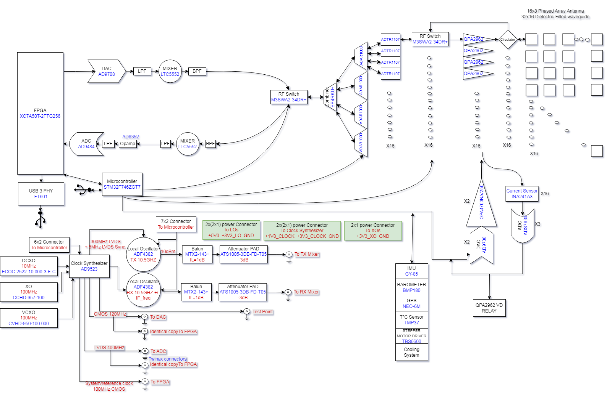
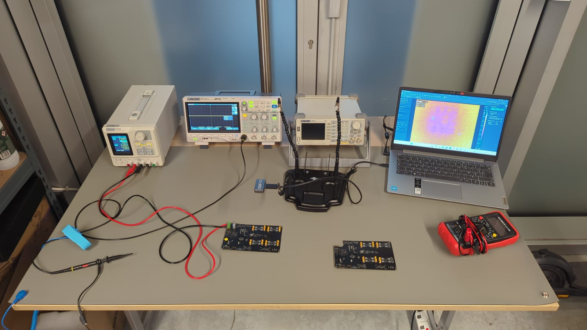
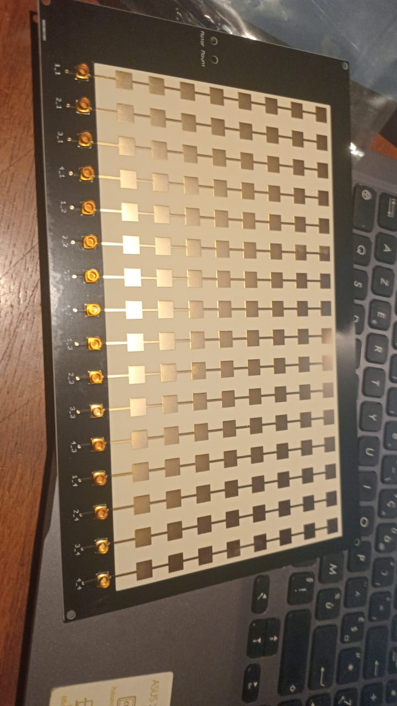

# 开源脉冲线性调频相控阵雷达

源文件：`1_Project_Description/Project_Description.docx`  
SHA256：`a74e00b3803bbcd5689f979dc48a92f1e1efca9f17f544aa341c951d9e57f8c7`  
翻译范围：全部正文、清单及图中可识别文字；图片原样保留，图中文字另给中文对照。DOCX 无稳定页码，以章节和图片序号定位。原文关于已实现功能、距离、器件型号的陈述均照译，本轮未做硬件或仿真复验。

参考编号、日期、原始提案日期：原文均留空。

## 项目说明

这是一款开源、低成本的 10.5 GHz 相控阵雷达，采用相控阵天线和脉冲 LFM 调制，提供 3 km 和 20 km 探测距离版本，面向研究人员、无人机开发者及有深入经验的 SDR 爱好者。

## 2.0 技术规格

### 2.1 系统架构概览

AERIS-10 有两个版本：

- AERIS-10N（Nexus）：距离最高 3 km。
- AERIS-10X（Extended）：扫描距离最高 20 km。
- 频率：10.5 GHz。
- 天线：Nexus 使用 8×16 贴片天线阵列；Extended 使用 32×16 介质填充开槽波导天线阵列。
- 俯仰和方位波束可电子控制。原型使用 16 个天线单元控制俯仰，方位由步进电机控制；系统设计可进一步改造为俯仰和方位均电子控制。原文此处括号未闭合。
- 输出：多个目标的距离和多普勒信息。
- 界面：Python 编写的 GUI。

### 当前状态：Alpha 原型

为了测试、验证及降低原型成本，当前原型在一块 PCB 上集成电源管理、数字器件、模拟及混合信号器件、射频部分。

量产系统将使用分离模块，以降低 EMI、提高信号完整性，同时采用更专业的时钟源和频率合成器。原文称新原理图、PCB 布局和固件已经提供。

### 理解系统硬件

AERIS-10 的主要子系统如下：

- 电源管理板：提供所有电子器件所需的电压，配合适当滤波和上电时序；时序由微控制器保证。
- 频率合成板：使用高性能、低抖动时钟发生器 AD9523-1，为 RX/TX 频率合成器 ADF4382、DAC、ADC 和 FPGA 提供相位对齐的参考时钟。
- 主板包括：生成雷达 chirp 的 DAC；两个微波混频器 LT5552，分别用于上变频和中频下变频；四个四通道 ADAR1000 移相器，用于 RX/TX 链；16 个 ADTR1107 前端芯片，同时承担接收低噪声放大和发射功率放大。
- XC7A100T FPGA 承担雷达信号处理：通过 DAC 生成 PLFM chirp、读取原始 ADC 数据、AGC、I/Q 基带下变频、抽取、滤波、正向 FFT、脉冲压缩、多普勒/MTI/CFAR 处理及 USB 接口。
- STM32F746xx 微控制器：保证正确的上电、掉电时序（见电源管理 Excel 文件），与 FPGA 通信，并配置及连接下列设备：AD9523-1 时钟发生器；两个 ADF4382 合成器；四个 ADAR1000，用于正确的雷达脉冲时序；功放板上的两个 ADS7830 ADC，用于测量 16 块功放板的 Idq；两个 DAC5578，用于控制 16 块功放板的 Vg；GPS，用于设置 GUI 地图中心；GY_85 IMU，用于对处理后的目标经纬度进行俯仰和横滚修正；BMP180 气压计；步进电机；原文所称用于启动冷却风扇的八个 ADS7830 温度传感器；射频开关。
- 16 块功率放大器板，仅用于原文写作 AERIS-10E 的版本，采用 10 W QPA2962 GaN 放大器以扩展距离。
- Nexus 的 8×16 贴片天线板，以及 Extended 的 32×16 介质填充开槽波导阵列。
- 其他部件：滑环、步进电机及驱动器、冷却风扇、外壳等。

译注：以上 AERIS-10E 与前文 AERIS-10X 的名称不一致，器件写法 LT5552、DAC5578 和 ADS7830“温度传感器”均保留原文，未擅自改成其他型号或器件类型。

### 2.4 软件与处理

AERIS-10 由三个协同工作的核心处理部分构成：STM32 管理系统和外设，FPGA 实时处理信号，GUI 提供控制和可视化。以下描述完整启动顺序和操作循环，即系统如何唤醒、校准并开始扫描。

#### 系统启动和初始化

首次加电时，STM32 按严格顺序启动子系统，在任何射频活动开始前保证电源和参考时钟稳定。

第一步是等待 OCXO（恒温晶体振荡器）达到热稳定。该高精度参考源约需三分钟预热并稳定；原文称不等待将导致雷达频率精度漂移，影响距离分辨率和目标探测。

OCXO 稳定后，STM32 管理 AD9523 时钟发生器的电压时序，保证电源轨按正确顺序达到规定电平，然后配置 AD9523，建立为 FPGA 和所有射频器件提供精确、相位对齐时序的时钟分配。

时钟建立后，STM32 为 FPGA 进行上电时序控制，随后初始化其余外设：GPS 开始获取卫星锁定；IMU 和气压计初始化用于姿态、海拔感知；两个 ADF4382（发射、接收各一个）完成配置；四个 ADAR1000 初始化，用于控制 16 个相控阵单元。至此硬件就绪，系统等待 GUI 的启动命令。

#### GUI 连接和系统准备

操作者在连接的计算机上运行自定义 GUI，并按 Start 按钮开始操作。

GUI 立即向 STM32 发送启动标志包，预定义字节序列为 `{23, 46, 158, 237}`，作为确认通信建立的握手。随后 GUI 发送扫描所需全部操作设置，包括波形参数、扫描模式和距离设置等。

STM32 确认这些设置并监测 GPS 数据流，等待有效锁定后，向 GUI 返回包含经度、纬度和海拔的调制位置数据流。GUI 以这些坐标为雷达当前位置设置地图中心，使操作者能直接了解目标空间位置。

#### 姿态确定和机械对准

在持续更新 GPS 位置的同时，STM32 不断读取 IMU 和气压计原始数据。IMU 数据用于计算俯仰、横滚、偏航角；气压计提供辅助海拔参考。

获得偏航角（航向）后，STM32 控制步进电机旋转天线组件，使其对准 `yaw = 0°`，通常是真北或预定义方向。此机械对准保证后续电子扫描波束都基于一致的绝对方向。

#### 发射和接收链配置

发射任何雷达脉冲之前，必须精确调谐射频前端。STM32 配置两个 ADF4382，分别设为发射和接收频率，然后执行两个合成器之间的相位同步，使发射和接收本振相干。此相干性对于多普勒处理和相干脉冲压缩至关重要。

#### 扫描循环：三层嵌套结构

扫描由三层嵌套循环控制：

1. chirp 序号 `m`：一个突发中的单个频率斜坡。
2. 波束扫描序号 `n`：32 个俯仰/方位位置的电子扫描。
3. 机械方位序号 `y`：每圈 50 个位置的物理旋转。

电子波束扫描在脉冲重复间隔内快速进行，机械旋转较慢、覆盖 360°；两者共同实现完整体积扫描。

循环变量：

- `m` 是突发内 chirp 编号，每个突发含 32 个 chirp：先以 PRF1（脉冲重复频率 1）发射 16 个持续 T1 的 chirp，然后等待 175.4 µs 保护间隔，再以 PRF2 发射 16 个持续 T2 的 chirp。
- `n` 为 1～32 的电子扫描序号；依扫描模式对应俯仰或方位波束位置，由 ADAR1000 的相位设置控制。
- `y` 为 1～50 的机械方位序号；步进电机每圈移动到 50 个离散位置，机械完成方位扫描，电子在正交平面快速扫描。

#### 操作循环

STM32 先命令步进电机移动到第一个方位位置 `y = 1`，位置稳定后依次执行：

1. 把 ADAR1000 移相器设为波束位置 `n` 对应值。
2. 管理 ADTR1107（原文此处称射频开关）和射频功率放大器的电压时序，保证正常上电。
3. 向 FPGA 发送发射模式标志，并配置 ADAR1000 进行发射。
4. FPGA 通过 DAC 生成 chirp 波形，驱动发射阵列。
5. 发射结束后 FPGA 立即通知 STM32 切换至接收模式。
6. STM32 把 ADAR1000 重新配置为接收。
7. FPGA 通过 ADC 捕获回波，并开始处理：中频下变频为基带、滤波、使用 CIC/FIR/NCO 提取 I/Q 分量、脉冲压缩、逐距离多普勒 FFT、MTI、CFAR 检测、输出检测报告（含小型距离—多普勒缩略图）。
8. 经 FTDI 接口把 FPGA 处理后的雷达数据发送至 GUI。
9. GUI 实时更新图表，在地图上叠加显示检测目标。

#### 循环迭代与扫描完成

完成 chirp `m` 的处理后，`m` 加 1，并返回原文所称第 34 步（DAC 生成 chirp）。当 `m > 32` 时，`m` 重置为 1，`n` 加 1，转至下一电子波束位置，并返回原文第 29 步（设置 ADAR1000 新相位）。

当 `n > 32` 时，`n` 重置为 1，`y` 加 1，步进电机转至下一机械方位；当 `y > 50`，完成一圈后 `y` 重置为 1。扫描持续进行，直到操作者停止。译注：原文正文没有可对应的第 29/34 步编号，保留其引用，不擅自重新建立对应关系。

此循环形成完整三维雷达图像：电子扫描快速覆盖俯仰/方位，机械旋转覆盖全部 360° 方位。

#### 概要

原文把 STM32 比作“指挥”：安排电源时序、配置外设、管理电机及协调模式切换；把 FPGA 比作“乐团”：生成波形、捕获回波并运行繁重信号处理；把 GUI 比作“观众视角”：显示地图、目标并允许操作者控制。

这种分工使各处理器专注于擅长任务，形成相干、高性能且通过开放架构保持灵活可编程的雷达系统。

### 原文称已工作的功能

- 16×8 阵列波束形成。
- 俯仰方向 ±45° 电子扫描。
- 脉冲 LFM 生成和接收。
- 至 1 km 的基本目标探测。
- FPGA 原始数据捕获及处理：DAC 生成 FM chirp、读取原始 ADC 数据、AGC、I/Q 基带下变频、抽取、滤波、正向 FFT、脉冲压缩、多普勒、MTI、CFAR。

### 正在开展的工作

- 将雷达处理移到 Python GUI，并对比 FPGA 与 Python 两种方式的性能。
- 使用多块同步雷达板，提高波束扫描分辨率和距离。
- 发起众筹活动。

### 参与项目

作者正在寻找 Beta 测试者（大学研究人员、无人机初创企业、有经验的创客）、审查设计的 RF 工程师、优化信号处理的 FPGA 开发者，以及开发 Python/C++ SDK 的软件开发者。

项目链接：[Hackaday 项目](https://hackaday.io/project/205190-open-source-plfm-radar-up-to-20km-range)、[GitHub 项目](http://www.github.com/NawfalMotii79/PLFM_RADAR)。链接仅为原文转录，本轮未浏览。

## 原文插图及中文对照

DOCX `word/media` 共含四个图像资源；正文内嵌图形计数为 3，另一资源为品牌标识。以下全部保留。

### 图像 1：系统方框图

图中主要文字对照：FPGA `XC7A50T-2FTG256`；DAC 数模转换器 `AD9708`；ADC 模数转换器 `AD9484`；LPF 低通滤波器；BPF 带通滤波器；MIXER 混频器 `LTC5552`；Opamp 运算放大器 `AD8352`；Microcontroller 微控制器 `STM32F746ZGT7`；USB 3 PHY 为 USB 3 物理层 `FT601`；RF Switch 射频开关 `M3SWA2-34DR+`；Combiner 合路器 `EP4RKU+`；Circulator 环行器；16×8 相控阵天线；32×16 介质填充波导；Current Sensor 电流传感器 `INA241A3`；QPA2962 VD RELAY 为 QPA2962 漏极电压继电器。

时钟部分：OCXO 恒温晶振（10 MHz，`ECOC-2522-10.000-3-F-C`）；XO 晶体振荡器（100 MHz，`CCHD-957-100`）；VCXO 压控晶体振荡器（100 MHz，`CVHD-950-100.000`）；Clock Synthesizer 时钟合成器 `AD9523`；Local Oscillator 本地振荡器 `ADF4382`，TX 为 10.5 GHz，RX 为 `10.5 GHz +/- IF_freq`；Balun 巴伦 `MTX2-143+`（IL 插入损耗 1 dB）；Attenuator PAD 衰减垫 `ATS1005-3DB-FD-T05`（−3 dB）；300 MHz LVDS 加 5 MHz LVDS 同步；CMOS 120 MHz 接 DAC；LVDS 400 MHz 接 ADC；100 MHz CMOS 系统/参考时钟接 FPGA；Identical copy to FPGA 表示相同信号复制给 FPGA；Twinax connectors 双轴连接器；Test Point 测试点；To TX/RX Mixer 接发射/接收混频器。

连接器标注：7×2 和 6×2 连接器接微控制器；2×(2×1) 本振电源连接器 `+5V0 +3V3_LO GND`；2×(2×1) 时钟合成器电源连接器 `+1V8_CLOCK +3V3_CLOCK GND`；2×1 晶振电源连接器 `+3V3_XO GND`。外设：IMU 惯性测量单元 `GY-85`、BAROMETER 气压计 `BMP180`、GPS `NEO-6M`、T°C Sensor 温度传感器 `TMP37`、STEPPER MOTOR DRIVER 步进电机驱动器 `TBS6600`、Cooling System 冷却系统。器件标识保持图中写法；照片/图中的型号与正文有差异，详见审阅发现。

### 图像 2：实验台照片

中文说明：实验台上可见电源、示波器、射频仪器、笔记本电脑、万用表及电路板。屏幕中的小字和测量值未逐字辨识，不能据照片证明某一性能已经达到。

### 图像 3：天线阵列照片

中文说明：贴片阵列实物及多路射频连接器。可识别标注 `Motor Mount` 为电机安装位置；其余端口编号照原图保留。

### 图像 4：品牌标识

`ABAC INDUSTRY`：品牌名保留；`ELECTRONICS ENGINEERING`：电子工程。
